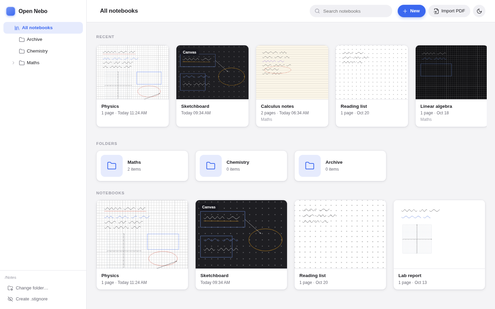
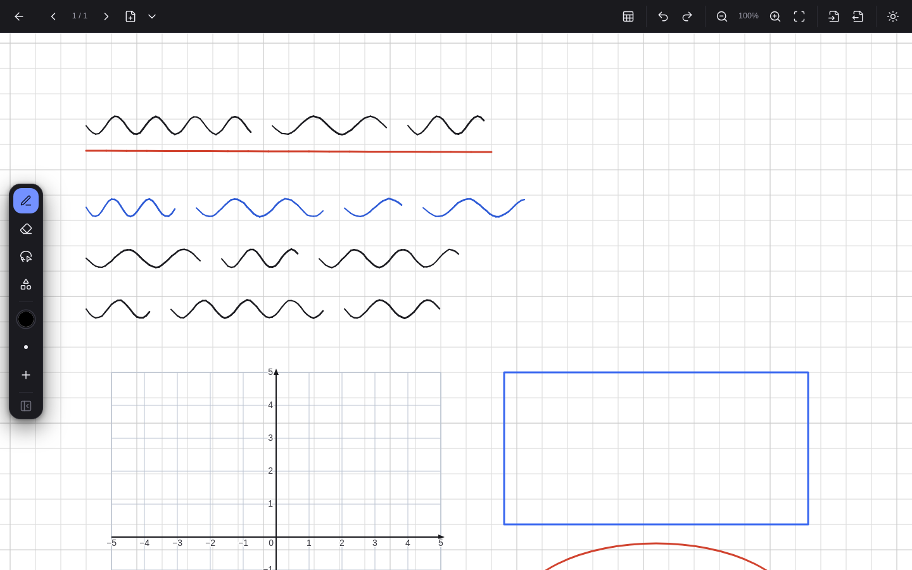

# Open Nebo

An open-source, cross-platform (Linux + Windows) handwritten-notebook app. Notebooks are
`.onb` files ("Open Nebo Book", a zip, MIME `application/vnd.opennebo+zip`) that live in a
folder synced by [Syncthing](https://syncthing.net), the same way an Obsidian vault does.

**Status: early (0.2).** Pen types, layers, text, a page sidebar, backgrounds, PDF/PNG/SVG export,
search and the sync-safety layer work. Tablet input (palm rejection, stylus buttons) is implemented but has not
been tried on real pen hardware yet. See limitations below.

<p>
  
  
</p>

The interface follows light and dark system themes (with a manual toggle), uses a floating tool
palette and icons throughout (icons are [Lucide](https://lucide.dev), ISC licence, in
`ui/vendor/LUCIDE-LICENSE`).

## Features

- Infinite pannable, zoomable canvas; pressure pen, highlighter, pencil and marker; stroke, point and
  highlighter-only erasers; smart shapes with optional snap-to-grid; lasso/marquee select; typed text boxes;
  images, coordinate grids and graph paper; undo and redo (300 steps).
- Layers (hide, lock, reorder), a page sidebar with thumbnails and drag-to-reorder, and an infinite-board mode.
- Backgrounds: light, dark, paper, dot grid, grid, blueprint, isometric, triangle and perspective guides, with
  automatic ink that flips between black and light when the background changes.
- PDF import (as page backgrounds) and PDF, PNG and SVG export.
- Library with folders, recents, and search of notebook names and typed text.
- Editable keyboard shortcuts; light and dark themes.

## Layout

- `crates/nebo-core` — package format + vault/sync-safety logic (tested, no GUI).
- `src-tauri` — Tauri 2 desktop shell. `ui/` — plain HTML/JS canvas front end.
- `docs/NEBO_FORMAT_FINDINGS.md` — what was recovered about the Nebo format, and what's unknown.

## Syncing with Syncthing

Point Syncthing at your notebook folder (default `~/Documents/Nebo`) on each device and
choose the same folder in the app. The app:

- saves atomically via `.syncthing.<name>.tmp` + rename, so half-written files never sync;
- refuses to overwrite a file whose contents changed on disk since you opened it
  (revision check) and tells you instead of clobbering a synced version;
- reloads open notebooks when Syncthing delivers a newer version and you have no unsaved edits;
- lists `*.sync-conflict-*` copies, flagged;
- opens legacy `.nebo` files written by Open Nebo 0.1.x; saving writes the same-named `.onb`
  next to the original (which is left untouched and hidden from the list once the `.onb` exists);
- keeps no lock files in the folder. "Create .stignore" adds a minimal ignore file.

## Build

```
cargo test --workspace
(cd ui && node --test)
cd src-tauri && cargo tauri dev        # needs: cargo install tauri-cli --version "^2"
cargo tauri build
```

Linux needs `webkit2gtk-4.1`. Windows builds come from the GitHub Actions workflow
(`.github/workflows/build.yml`, `windows-latest`, WebView2); they have not been built or run yet.

## Limitations (important)

- **The format is Open Nebo's own.** It is loosely modelled on iink-style packages but makes no
  promise of compatibility with MyScript's Nebo app; opening real Nebo notebooks is out of scope.
  Packages with binary members (`*.bdom`, `*.bink`) are rejected with a clear error, not guessed
  at. Unknown archive members are preserved on save.
- No handwriting recognition. MyScript's engine is proprietary; a recognizer plug-in point is future work.
- PDF import/export is raster-only: imported pages are images (no text selection/links), export is a page image per page. JPEG 2000 images inside PDFs may not render.
- No math or diagram recognition. Search covers typed text and notebook names only, not handwriting.
- SVG export draws isometric, triangle and perspective backgrounds as a solid colour, and wraps text with an
  estimated character width.
- Not tested with a physical pen/touch device; the Windows installer has not been built or run by the author.
- The point eraser also removes any shape it touches (it only splits freehand strokes).
- Hide/lock of the base layer and the active layer are not saved with the notebook.

## Disclaimer

Open Nebo is an independent project and is not affiliated with or endorsed by MyScript /
Myscript SAS. "Nebo" and "MyScript" are trademarks of their owners. No MyScript code, models
or assets are included; file-format notes come from inspecting a publicly distributed app
package for interoperability. Licensed under MIT (see `LICENSE`).
